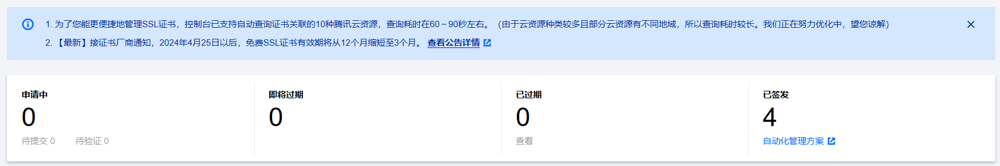
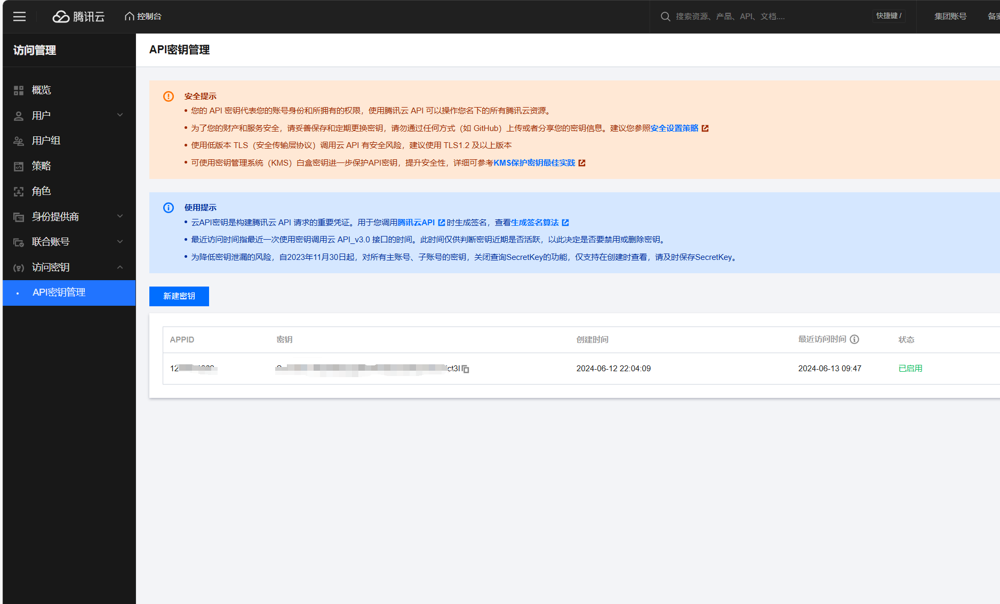
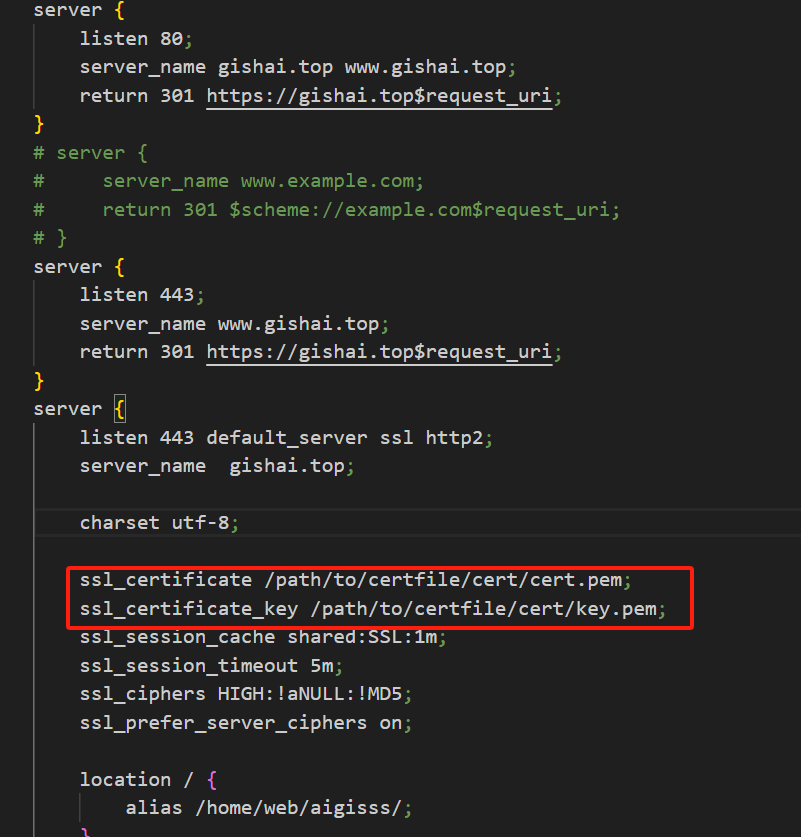
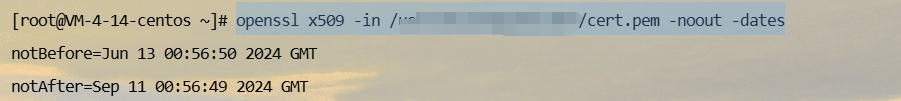
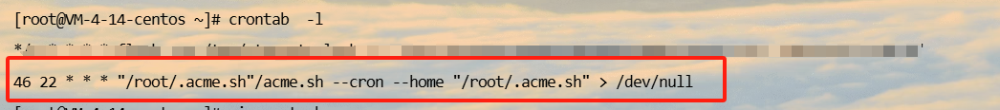

#### 前言

每次申请`ssl`都觉得停麻烦的，还要各种拷贝和解析，每个二级域名还得每个申请。前几天进入自己的网站发现小绿标已经没了，取而代之的是不安全，登录购买域名的网站发现只能申请3个月免费的`SSL`证书。于是上网寻找其他的解决方案，发现`acme.sh`能解决我的问题。



#### 简介

`acme.sh` 实现了 `acme `协议, 可以从 `LetsEncrypt` 生成免费的证书并自动续期`LetsEncrypt`免费`SSL`证书。

>`Let's Encrypt`是一个于2015年三季度推出的数字证书认证机构，旨在以自动化流程消除手动创建和安装证书的复杂流程，并推广使万维网服务器的加密连接无所不在，为安全网站提供免费的SSL/TLS证书。
>-- 摘自 维基百科

acme.sh 仓库地址：[acme.sh](https://github.com/acmesh-official/acme.sh)
acme.sh 中文说明：[官方中文说明](https://github.com/acmesh-official/acme.sh/wiki/说明)
各个 dnsapi 说明：[dnsapi](https://github.com/acmesh-official/acme.sh/wiki/dnsapi)

#### 安装

安装 acme，后面my@example.com换成自己的邮箱

```bash
curl https://get.acme.sh | sh -s email=my@example.com
```

如果上面官方下载地址失败 或者 太慢，可以选用国内的备用地址

```bash
curl https://gitcode.net/cert/cn-acme.sh/-/raw/master/install.sh?inline=false | sh -s email=my@example.com
```

然后在 root 目录下`ls -a`就可以看到有一个`.acme.sh`的[文件夹](https://so.csdn.net/so/search?q=文件夹&spm=1001.2101.3001.7020)，进入后里面有个 account.conf 配置文件，里面有前面安装时填写的邮箱，不知道有什么用，估计到时候会给通知什么的吧

###### 设置别名 alias:

```
alias acme.sh=~/.acme.sh/acme.sh 
```

进入.acme.sh 目录后使用下面命令开启 acme 自动更新

首先最好先切换一下证书类型，其他类型的证书可能访问出错

```
acme.sh --set-default-ca --server letsencrypt
```

#### 验证

通过官方说明文档可知，acme.sh 申请证书有两种方式，[http](https://so.csdn.net/so/search?q=http&spm=1001.2101.3001.7020) 和 dns 验证

**acme.sh** 实现了 **acme** 协议支持的所有验证协议. 一般有两种方式验证: http 和 dns 验证.

##### 1. http 方式需要在你的网站根目录下放置一个文件, 来验证你的域名所有权,完成验证. 然后就可以生成证书了.

```
acme.sh --issue -d mydomain.com -d www.mydomain.com --webroot /home/wwwroot/mydomain.com/
```

只需要指定域名, 并指定域名所在的网站根目录. **acme.sh** 会全自动的生成验证文件, 并放到网站的根目录, 然后自动完成验证. 最后会聪明的删除验证文件. 整个过程没有任何副作用.

如果你用的 **apache**服务器, **acme.sh** 还可以智能的从 **apache**的配置中自动完成验证, 你不需要指定网站根目录:

```
acme.sh --issue -d mydomain.com --apache
```

如果你用的 **nginx**服务器, 或者反代, **acme.sh** 还可以智能的从 **nginx**的配置中自动完成验证, 你不需要指定网站根目录:

```
acme.sh --issue -d mydomain.com --nginx
```

**注意, 无论是 apache 还是 nginx 模式, acme.sh在完成验证之后, 会恢复到之前的状态, 都不会私自更改你本身的配置. 好处是你不用担心配置被搞坏, 也有一个缺点, 你需要自己配置 ssl 的配置, 否则只能成功生成证书, 你的网站还是无法访问https. 但是为了安全, 你还是自己手动改配置吧.**

如果你还没有运行任何 web 服务, **80** 端口是空闲的, 那么 **acme.sh** 还能假装自己是一个webserver, 临时听在**80** 端口, 完成验证:

```
acme.sh --issue -d mydomain.com --standalone
```

acme.sh脚本默认ca服务器是zerossl，经常出错，会导致获取证书的时候一直出现：Pending, The CA is processing your order, please just wait.

只需要把ca服务器改成letsencrypt 即可，虽然更改以后还是有概率出现pending，但基本2-3次即可成功

```
acme.sh --set-default-ca --server letsencrypt
```

更高级的用法请参考: https://github.com/Neilpang/acme.sh/wiki/How-to-issue-a-cert

##### 2. 手动 dns 方式, 手动在域名上添加一条 txt 解析记录, 验证域名所有权.

这种方式的好处是, 你不需要任何服务器, 不需要任何公网 ip, 只需要 dns 的解析记录即可完成验证. 坏处是，如果不同时配置 Automatic DNS API，使用这种方式 acme.sh 将无法自动更新证书，每次都需要手动再次重新解析验证域名所有权。

```
acme.sh --issue --dns -d mydomain.com \
 --yes-I-know-dns-manual-mode-enough-go-ahead-please
```

然后, **acme.sh** 会生成相应的解析记录显示出来, 你只需要在你的域名管理面板中添加这条 txt 记录即可.

等待解析完成之后, 重新生成证书:

```
acme.sh --renew -d mydomain.com \
  --yes-I-know-dns-manual-mode-enough-go-ahead-please
```

注意第二次这里用的是 `--renew`

dns 方式的真正强大之处在于可以使用域名解析商提供的 api 自动添加 txt 记录完成验证.

**acme.sh** 目前支持 cloudflare, dnspod, cloudxns, godaddy 以及 ovh 等数十种解析商的自动集成.

以 dnspod 为例, 你需要先登录到 dnspod 账号, 生成你的 api id 和 api key, 都是免费的. 然后:

```
export DP_Id="1234"
export DP_Key="sADDsdasdgdsf"
acme.sh --issue --dns dns_dp -d aa.com -d www.aa.com
```

证书就会自动生成了. 这里给出的 api id 和 api key 会被自动记录下来, 将来你在使用 dnspod api 的时候, 就不需要再次指定了. 直接生成就好了:

```
acme.sh --issue -d mydomain2.com --dns  dns_dp
```

更详细的 api 用法: https://github.com/Neilpang/acme.sh/blob/master/dnsapi/README.md

我的是腾讯云的域名，需要腾讯云key到环境变量。[访问密钥 - 控制台 (tencent.com)](https://console.cloud.tencent.com/cam/capi)



```bash
export Tencent_SecretId=""
export Tencent_SecretKey=""
```

#### 申请&安装

前面证书生成以后, 接下来需要把证书 copy 到真正需要用它的地方.

注意, 默认生成的证书都放在安装目录下: `~/.acme.sh/`, 请不要直接使用此目录下的文件, 例如: 不要直接让 nginx/apache 的配置文件使用这下面的文件. 这里面的文件都是内部使用, 而且目录结构可能会变化.

正确的使用方法是使用 `--install-cert` 命令,并指定目标位置, 然后证书文件会被copy到相应的位置, 例如:

##### Apache example:

```
acme.sh --install-cert -d example.com \
--cert-file      /path/to/certfile/in/apache/cert.pem  \
--key-file       /path/to/keyfile/in/apache/key.pem  \
--fullchain-file /path/to/fullchain/certfile/apache/fullchain.pem \
--reloadcmd     "service apache2 force-reload"
```

##### Nginx example:

```
acme.sh --install-cert -d example.com \
--key-file       /path/to/keyfile/in/nginx/key.pem  \
--fullchain-file /path/to/fullchain/nginx/cert.pem \
--reloadcmd     "service nginx force-reload"
```

(一个小提醒, 这里用的是 `service nginx force-reload`, 不是 `service nginx reload`, 据测试, `reload` 并不会重新加载证书, 所以用的 `force-reload`)

Nginx 的配置 `ssl_certificate` 使用 `/etc/nginx/ssl/fullchain.cer` ，而非 `/etc/nginx/ssl/<domain>.cer` ，否则 [SSL Labs](https://www.ssllabs.com/ssltest/) 的测试会报 `Chain issues Incomplete` 错误。

`--install-cert`命令可以携带很多参数, 来指定目标文件. 并且可以指定 reloadcmd, 当证书更新以后, reloadcmd会被自动调用,让服务器生效.

详细参数请参考: https://github.com/Neilpang/acme.sh#3-install-the-issued-cert-to-apachenginx-etc

值得注意的是, 这里指定的所有参数都会被自动记录下来, 并在将来证书自动更新以后, 被再次自动调用.

我选择`DNS`方式，在我`centos`服务器执行以下命令

```bash
acme.sh --install-cert --issue --dns dns_tencent -d gishai.top -d *.gishai.top --key-file   /path/to/certfile/cert/key.pem  --fullchain-file /path/to/certfile/cert/cert.pem --reloadcmd     "service nginx force-reload"
```

nginx配置中修改路径



#### 查看

看看网站重新有了小绿标，证书看看还有多久过期。

```sh
openssl x509 -in /path/to/certfile/cert/cert.pem -noout -dates
```



看看有木有自动任务，因为证书3个月就过期了。

```sh
 crontab  -l
```



目前一切正常，两个月后再看看