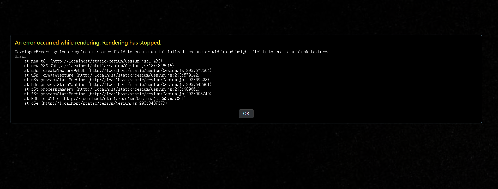
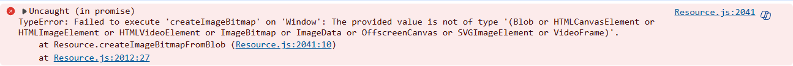
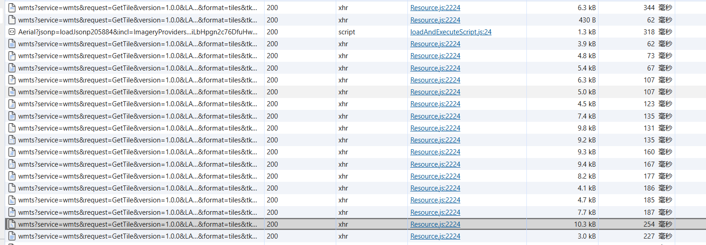
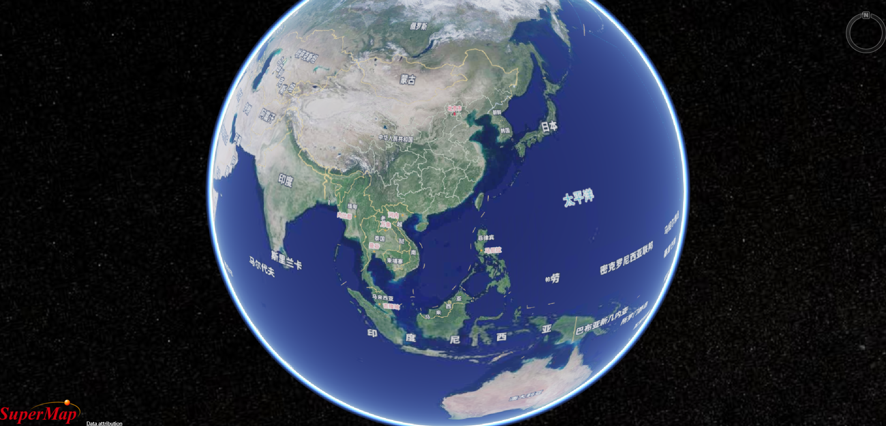

 在vue中使用超图的`@supermap/iclient3d-webgl`出现地图加载出错的问题



面向搜索引擎一番，没有发现类似问题，然后换原生`Cesium`加载试试，得到的是一个没有底图的球


报错信息如下

于是仔细研究报错信息，发现它说的是提供的数据格式不对，开`F12`查看请求数据，好像也没啥异常



偶然见看见掘金一篇文章[mockjs 导致cesium地图无法加载 - 掘金 (juejin.cn)](https://juejin.cn/post/7143579664424894472)

按照文章的方法修改mock.js的源码。 代码路径：项目//node_modules/mockjs/dist/mock.js 大约在8360行：

```js
// 原生 XHR
                if (!this.match) {
                    this.custom.xhr.send(data)
                    return
                }

```

修改为

```js
// 原生 XHR

                if (!this.match) {
                    this.custom.xhr.responseType = this.responseType
                    this.custom.xhr.send(data)
                    return
                }

```

地球底图成功显示出来，但是这个方法不好，其他同事还得修改源码，重写mock的send方法,其实最主要的是修改`responseType`,因为这mock源代码中,`responseType`是直接为空的

```js
Mock.XHR.prototype.send = (() => {
  const _send = Mock.XHR.prototype.send

  return function() {
    if (!this.match) {
      this.custom.xhr.responseType = this.responseType || ''

      this.custom.xhr.timeout = this.timeout || 0

      this.custom.xhr.withCredentials = this.withCredentials || false

      this.custom.xhr.onabort = this.onabort || null

      this.custom.xhr.onerror = this.onerror || null

      this.custom.xhr.onload = this.onload || null

      this.custom.xhr.onloadend = this.onloadend || null

      this.custom.xhr.onloadstart = this.onloadstart || null

      this.custom.xhr.onprogress = this.onprogress || null

      this.custom.xhr.onreadystatechange = this.onreadystatechange || null

      this.custom.xhr.ontimeout = this.ontimeout || null
    }

    return _send.apply(this, arguments)
  }
})()

```

最后小破球就成功显示出来了



\>参考文章：

\>

\>- [vue2+cesium加载离线地图报错_failed to execute 'createimagebitmap' on 'window':-CSDN博客](https://blog.csdn.net/qq_29559239/article/details/129417777)

\>- [mockjs 导致cesium地图无法加载 - 掘金 (juejin.cn)](https://juejin.cn/post/7143579664424894472)

\>- [记录一次使用mockjs出现诡异问题_at gltfloader.parse-CSDN博客](https://blog.csdn.net/ok2547881370/article/details/110820740)